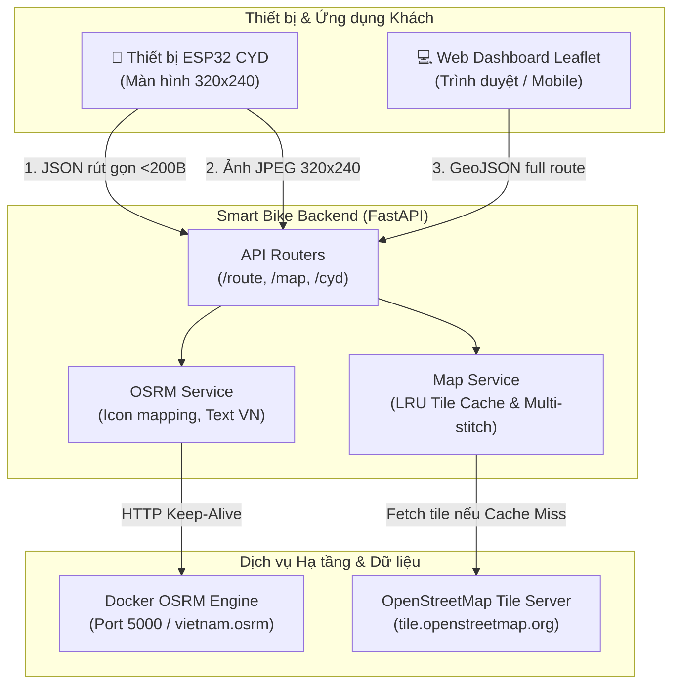

# 🚴 Smart Bike Backend

[](https://fastapi.tiangolo.com)
[](https://www.python.org/)
[](https://www.docker.com/)
[](https://opensource.org/licenses/MIT)

**Smart Bike Backend** là hệ thống máy chủ điều hướng theo thời gian thực (Turn-by-turn Navigation) và cung cấp dữ liệu telemetry cho thiết bị xe đạp thông minh chạy vi điều khiển **ESP32 CYD** (Cheap Yellow Display - màn hình màu 320x240).

Hệ thống kết hợp sức mạnh của **FastAPI**, công cụ định tuyến mã nguồn mở **OSRM** (Open Source Routing Machine) và bản đồ **OpenStreetMap**, được thiết kế chuyên biệt để giải quyết bài toán giới hạn bộ nhớ RAM và băng thông truyền tải trên các thiết bị nhúng IoT.

---

## 🌟 Tính Năng Nổi Bật

* ⚡ **Endpoint JSON siêu gọn cho ESP32 (`/api/v1/route/cyd`)**:
  * Gói tin phản hồi chỉ khoảng **~200 bytes** (giảm hơn 98% dung lượng so với GeoJSON đầy đủ).
  * Vi điều khiển ESP32 giải mã bằng `ArduinoJson` trong **< 1ms**, tiết kiệm tối đa RAM vi điều khiển (SRAM 520KB).
  * Cung cấp sẵn mã icon màn hình (`icon_id` 1–7), khoảng cách bước rẽ, câu chỉ dẫn tiếng Việt tự nhiên, tổng cự ly và icon kế tiếp.
* 🗺️ **Render Map Tile siêu tốc với LRU In-Memory Cache**:
  * Render trực tiếp ảnh bản đồ JPEG kích thước 320x240 hiển thị lên màn hình LCD TFT của xe đạp.
  * Tích hợp bộ nhớ đệm **LRU Cache** trong RAM: giảm độ trễ phản hồi từ **1,200ms** xuống chỉ còn **< 3ms** (tăng tốc hơn 400 lần) và tránh bị OpenStreetMap giới hạn lượt truy vấn.
  * Tự động ghép nối đa tile (**multi-tile stitching 2x2**) chống viền đen, giữ vị trí xe đạp luôn ở chính tâm màn hình và vẽ điểm đích.
* 🚦 **Định tuyến tuân thủ luật giao thông**:
  * Tích hợp OSRM chạy profile `driving` để đảm bảo xe đạp đi đúng chiều đường giao thông tại Việt Nam (tránh đi ngược chiều).
* 🖥️ **Web Dashboard & Bộ Giả Lập Live (Leaflet.js)**:
  * Giao diện trực quan tìm kiếm địa điểm qua Nominatim, vẽ đường Polyline màu xanh và mô phỏng xe đạp chuyển động ở tốc độ 30 km/h.
* 🛡️ **Khả năng phục hồi & Chống sập**:
  * HTTP Connection Pooling tự động tái tạo kết nối khi event loop thay đổi.
  * Phân loại lỗi mạng, timeout và lỗi không tìm thấy đường (`NoRoute`) rõ ràng, không gây sập máy chủ.

---

## 🏗️ Kiến Trúc Hệ Thống



---

## 📁 Cấu Trúc Thư Mục

```text
bike-backend/
├── app/
│   ├── api/
│   │   ├── map_router.py       # API render tile bản đồ (/api/v1/map)
│   │   └── route_router.py     # API định tuyến & telemetry (/api/v1/route)
│   ├── core/
│   │   └── config.py           # Cấu hình Pydantic BaseSettings
│   ├── schemas/
│   │   └── navigation.py       # Pydantic Schemas (RouteResponse, CYDRouteResponse)
│   ├── services/
│   │   ├── map_service.py      # Xử lý ảnh Pillow, LRU Cache, Multi-tile stitch
│   │   └── osrm_service.py     # Gọi OSRM, map icon CYD, sinh câu tiếng Việt
│   ├── templates/
│   │   └── index.html          # Dashboard Leaflet.js mô phỏng xe đạp
│   └── main.py                 # FastAPI Lifespan & Application entrypoint
├── scripts/
│   ├── simulate_nav.py         # Giả lập lộ trình xuất file JSON & ảnh NavMap
│   ├── simulate_nav_frames.py  # Giả lập frame-by-frame 1 fps
│   └── test_nav_map.py         # Kịch bản kiểm tra tích hợp API
├── .env.example                # File mẫu biến môi trường
├── .gitignore                  # Cấu hình loại trừ Git toàn diện
├── docker-compose.yml          # Khởi chạy OSRM + Backend nhanh chóng
├── Dockerfile                  # Đóng gói ứng dụng backend
├── LICENSE                     # MIT License
├── README.md                   # Tài liệu hướng dẫn dự án
└── requirements.txt            # Danh sách gói phụ thuộc Python
```

---

## 🚀 Hướng Dẫn Cài Đặt & Khởi Chạy

### 1. Chuẩn bị Dữ liệu Bản đồ OSRM (Việt Nam)
Nếu bạn chưa có dữ liệu OSRM cho Việt Nam, tải file PBF và build OSRM bằng Docker:

```bash
# Tải dữ liệu bản đồ Việt Nam từ Geofabrik
wget https://download.geofabrik.de/asia/vietnam-latest.osm.pbf

# Build dữ liệu OSRM với profile xe hơi/xe đạp
docker run -t -v "${PWD}:/data" osrm/osrm-backend osrm-extract -p /opt/car.lua /data/vietnam-latest.osm.pbf
docker run -t -v "${PWD}:/data" osrm/osrm-backend osrm-partition /data/vietnam-latest.osrm
docker run -t -v "${PWD}:/data" osrm/osrm-backend osrm-customize /data/vietnam-latest.osrm
```

### 2. Chạy với Docker Compose (Khuyên dùng)
Chạy toàn bộ hệ thống (gồm cả OSRM container và FastAPI Backend) chỉ với một lệnh:

```bash
docker compose up -d
```

### 3. Chạy trực tiếp bằng Python Virtual Environment

```bash
# 1. Tạo và kích hoạt môi trường ảo
python3 -m venv .venv
source .venv/bin/activate  # Trên Linux/macOS
# hoặc .venv\Scripts\activate trên Windows

# 2. Cài đặt các thư viện cần thiết
pip install -r requirements.txt

# 3. Tạo file cấu hình từ file mẫu
cp .env.example .env

# 4. Chạy container OSRM ở cổng 5000 (nếu chưa chạy)
docker run -d --name smart-bike-osrm -p 5000:5000 -v "${PWD}:/data" osrm/osrm-backend osrm-routed --algorithm ch /data/vietnam-latest.osrm

# 5. Khởi chạy Backend FastAPI
uvicorn app.main:app --host 0.0.0.0 --port 8000 --reload
```

Sau khi chạy, mở trình duyệt truy cập:
* 🌐 **Dashboard mô phỏng**: `http://localhost:8000/`
* 📑 **Tài liệu API Swagger**: `http://localhost:8000/docs`

---

## 📡 Danh Sách API Endpoints

| Phương thức | Đường dẫn API | Mục đích |
| :--- | :--- | :--- |
| `GET` | `/` | Web Dashboard Leaflet & mô phỏng xe đạp |
| `GET` | `/api/v1/route/cyd` | **Chuyên dụng ESP32**: Trả JSON rút gọn (<200 bytes) |
| `GET` | `/api/v1/route` | Lấy lộ trình đầy đủ kèm mảng tọa độ GeoJSON |
| `GET` | `/api/v1/route/health` | Kiểm tra trạng thái sẵn sàng của OSRM Server |
| `GET` | `/api/v1/map/tile` | Lấy ảnh bản đồ JPEG 320x240 (có LRU Cache) |
| `GET` | `/api/v1/map/cache/stats` | Thống kê số lượng tile đang được lưu trong RAM |

---

## 📟 Tích Hợp Với ESP32 CYD

### Bảng Mã `icon_id` Hiển Thị Màn Hình

| ID | Ý nghĩa | Icon gợi ý |
| :---: | :--- | :---: |
| **1** | Đi thẳng | ⬆️ |
| **2** | Rẽ phải | ➡️ |
| **3** | Rẽ trái | ⬅️ |
| **4** | Ngoặt gấp phải | ↗️ |
| **5** | Ngoặt gấp trái | ↖️ |
| **6** | Quay đầu xe (U-turn) | ↩️ |
| **7** | Đã đến điểm đích | 🏁 |

### Mẫu Dữ Liệu Trả Về từ `/api/v1/route/cyd`

```json
{
  "status": "success",
  "icon_id": 2,
  "step_dist": 150.0,
  "step_name": "Đường Thanh Niên",
  "step_instruction": "Rẽ phải vào Đường Thanh Niên",
  "total_dist": 3450.0,
  "total_time": 420.0,
  "next_icon_id": 1,
  "message": null
}
```

### Mã Nguồn C++ Mẫu (Arduino / ESP32)

```cpp
#include <WiFi.h>
#include <HTTPClient.h>
#include <ArduinoJson.h>

void updateNavigation(float currentLat, float currentLon, float destLat, float destLon) {
    if (WiFi.status() != WL_CONNECTED) return;

    HTTPClient http;
    String url = "http://192.168.1.100:8000/api/v1/route/cyd?start_lat=" + String(currentLat, 6) +
                 "&start_lon=" + String(currentLon, 6) +
                 "&end_lat=" + String(destLat, 6) +
                 "&end_lon=" + String(destLon, 6);

    http.begin(url);
    int httpCode = http.GET();

    if (httpCode == 200) {
        StaticJsonDocument<384> doc;
        DeserializationError error = deserializeJson(doc, http.getString());
        if (!error && doc["status"] == "success") {
            int iconId = doc["icon_id"];
            float stepDist = doc["step_dist"];
            const char* instruction = doc["step_instruction"];
            float totalDist = doc["total_dist"];

            // Hiển thị lên màn hình TFT ESP32 CYD...
        }
    }
    http.end();
}
```

---

## 🧪 Chạy Kiểm Thử & Giả Lập

```bash
# Chạy script kiểm tra tích hợp API Route & Map Image:
python scripts/test_nav_map.py

# Chạy mô phỏng lộ trình Hồ Hoàn Kiếm -> Hồ Tây:
python scripts/simulate_nav.py
```

---

## 📄 Giấy Phép (License)

Dự án được phân phối dưới giấy phép [MIT License](LICENSE). Bạn hoàn toàn có thể tự do sử dụng, chỉnh sửa và tích hợp vào các dự án cá nhân hoặc thương mại.
