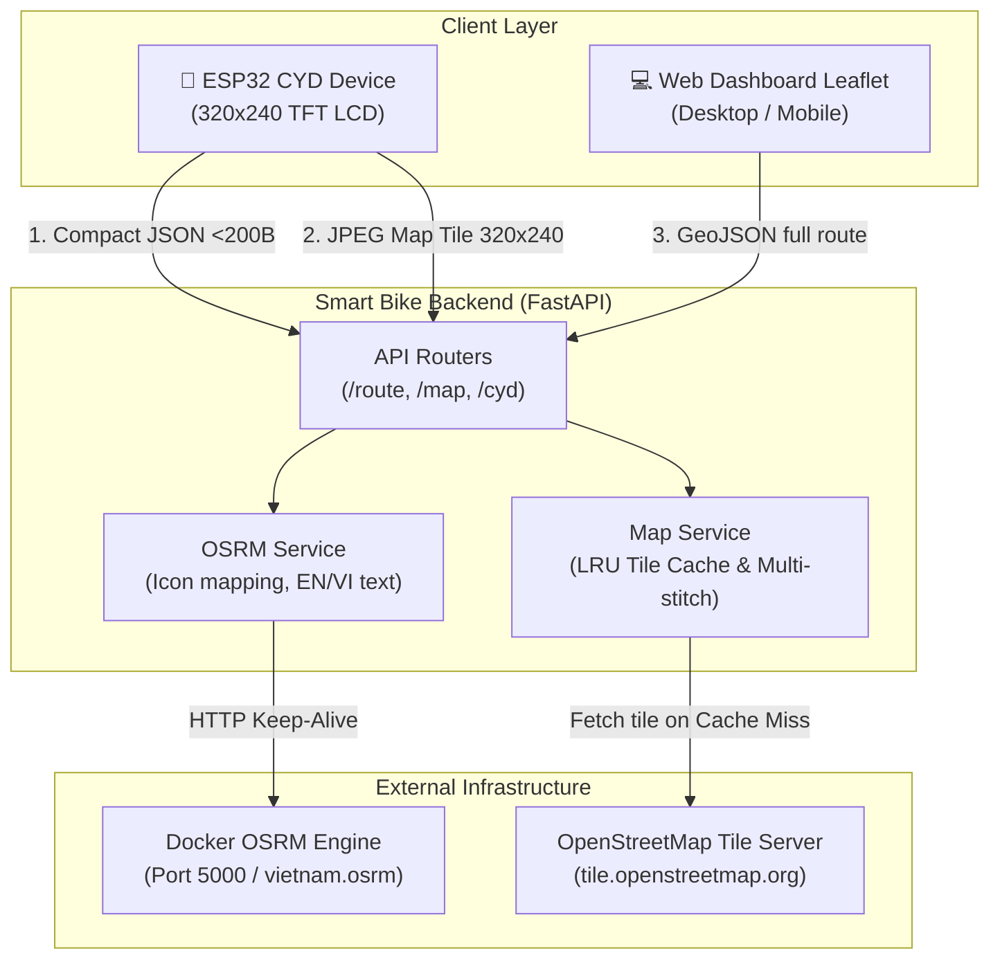

# 🚴 Smart Bike Backend

**English** • [Tiếng Việt](README.vn.md)

[](https://fastapi.tiangolo.com)
[](https://www.python.org/)
[](https://www.docker.com/)
[](https://opensource.org/licenses/MIT)

**Smart Bike Backend** is a high-performance, real-time turn-by-turn navigation and telemetry server tailored for smart bicycle computers powered by the **ESP32 CYD** (Cheap Yellow Display - 320x240 color TFT LCD).

Built on top of **FastAPI**, **OSRM** (Open Source Routing Machine), and **OpenStreetMap**, this backend is specifically engineered to overcome the strict memory (SRAM 520KB) and bandwidth constraints of IoT microcontrollers while providing an interactive Leaflet.js web simulator for real-time tracking.

---

## 🌟 Key Features

* ⚡ **Ultra-compact JSON Endpoint for ESP32 (`/api/v1/route/cyd`)**:
  * Response payload is trimmed down to **~200 bytes** (>98% size reduction compared to standard full GeoJSON routes).
  * Deserializes in **< 1ms** using `ArduinoJson` on the ESP32 without memory fragmentation or heap exhaustion.
  * Native bilingual support: pass `lang=en` (English) or `lang=vi` (Vietnamese).
  * Includes LCD turn icon ID (`icon_id` 1–7), distance to next turn, human-friendly turn guidance, total remaining distance, and next maneuver preview.
* 🗺️ **Blazing Fast Map Tile Generator with In-Memory LRU Cache**:
  * Renders 320x240 JPEG map tiles on-the-fly for direct display on the bicycle TFT screen.
  * Built-in **LRU Cache** in RAM: drops response latency from **1,200ms** (remote fetch) to **< 3ms** (>400x speedup), preventing OpenStreetMap tile rate limits.
  * Continuous **2x2 multi-tile stitching** eliminates black border artifacts, perfectly centers the bicycle marker, and draws the destination point and heading line.
* 🚦 **One-Way Street & Traffic Rule Compliance**:
  * Utilizes OSRM with road navigation profiles to prevent bicycles from routing into reverse-traffic one-way roads.
* 🖥️ **Live Web Dashboard & Route Simulator (Leaflet.js)**:
  * Interactive web UI for Nominatim place searching, route polyline preview, and real-time 30 km/h bicycle ride simulation.
* 🛡️ **Connection Resilience & Graceful Error Handling**:
  * Persistent HTTP Connection Pooling with automatic event-loop recreation (resolves `Event loop is closed`).
  * Structured handling for `NoRoute`, network disconnection, and invalid coordinate inputs.

---

## 🏗️ System Architecture



---

## 📁 Project Structure

```text
bike-backend/
├── app/
│   ├── api/
│   │   ├── map_router.py       # Map tile render endpoints (/api/v1/map)
│   │   └── route_router.py     # Routing & navigation endpoints (/api/v1/route)
│   ├── core/
│   │   └── config.py           # Pydantic BaseSettings centralized configuration
│   ├── schemas/
│   │   └── navigation.py       # Pydantic Schemas (RouteResponse, CYDRouteResponse)
│   ├── services/
│   │   ├── map_service.py      # Pillow rendering, LRU Cache, multi-tile stitcher
│   │   └── osrm_service.py     # OSRM client, CYD icon mapping, EN/VI instructions
│   ├── templates/
│   │   └── index.html          # Leaflet.js dashboard & bicycle simulator
│   └── main.py                 # FastAPI Lifespan & Application entrypoint
├── scripts/
│   ├── simulate_nav.py         # Route simulation & JSON/NavMap export
│   ├── simulate_nav_frames.py  # 1-FPS frame-by-frame snapshot generator
│   └── test_nav_map.py         # API integration test suite
├── .env.example                # Bilingual environment variables template
├── .gitignore                  # Comprehensive Git exclusion rules
├── docker-compose.yml          # 1-command startup for OSRM + Backend
├── Dockerfile                  # Container definition for backend
├── LICENSE                     # MIT License
├── README.md                   # English Documentation (Primary)
├── README.vn.md                # Vietnamese Documentation
└── requirements.txt            # Minimal production Python dependencies
```

---

## 🚀 Quickstart Guide

### 1. Prepare OSRM Map Data
If you don't already have an extracted OSRM dataset, download the OSM PBF file and extract it via Docker:

```bash
# Download Vietnam map data from Geofabrik (or your desired region)
wget https://download.geofabrik.de/asia/vietnam-latest.osm.pbf

# Extract and build OSRM graph
docker run -t -v "${PWD}:/data" osrm/osrm-backend osrm-extract -p /opt/car.lua /data/vietnam-latest.osm.pbf
docker run -t -v "${PWD}:/data" osrm/osrm-backend osrm-partition /data/vietnam-latest.osrm
docker run -t -v "${PWD}:/data" osrm/osrm-backend osrm-customize /data/vietnam-latest.osrm
```

### 2. Run with Docker Compose (Recommended)
Launch both the OSRM container and the FastAPI Backend with a single command:

```bash
docker compose up -d
```

### 3. Run Locally with Python Virtual Environment

```bash
# 1. Create and activate virtual environment
python3 -m venv .venv
source .venv/bin/activate  # On Linux/macOS
# or .venv\Scripts\activate on Windows

# 2. Install dependencies
pip install -r requirements.txt

# 3. Create .env from example template
cp .env.example .env

# 4. Start OSRM engine on port 5000 (if not already running)
docker run -d --name smart-bike-osrm -p 5000:5000 -v "${PWD}:/data" osrm/osrm-backend osrm-routed --algorithm ch /data/vietnam-latest.osrm

# 5. Start the FastAPI backend
uvicorn app.main:app --host 0.0.0.0 --port 8000 --reload
```

Once running, access:
* 🌐 **Simulator Dashboard**: `http://localhost:8000/`
* 📑 **Interactive Swagger Docs**: `http://localhost:8000/docs`

---

## 📡 API Reference

| Method | Endpoint | Key Parameters | Description |
| :--- | :--- | :--- | :--- |
| `GET` | `/` | - | Interactive Leaflet web simulator |
| `GET` | `/api/v1/route/cyd` | `start_lat`, `start_lon`, `end_lat`, `end_lon`, `lang=en\|vi` | **ESP32 Endpoint**: Compact JSON (<200 bytes) |
| `GET` | `/api/v1/route` | `start_lat`, `start_lon`, `end_lat`, `end_lon`, `lang=en\|vi` | Full route data with GeoJSON geometry |
| `GET` | `/api/v1/route/health` | - | Health check for backend and OSRM connectivity |
| `GET` | `/api/v1/map/tile` | `lat`, `lon`, `dest_lat`, `dest_lon`, `zoom=16` | Rendered 320x240 JPEG tile with LRU caching |
| `GET` | `/api/v1/map/cache/stats`| - | Real-time map tile memory cache statistics |

---

## 📟 ESP32 CYD Hardware Integration

### Turn `icon_id` Reference Table

| ID | English Meaning | Vietnamese Meaning | Suggested Icon |
| :---: | :--- | :--- | :---: |
| **1** | Continue straight | Đi thẳng | ⬆️ |
| **2** | Turn right | Rẽ phải | ➡️ |
| **3** | Turn left | Rẽ trái | ⬅️ |
| **4** | Turn sharp right | Ngoặt gấp sang phải | ↗️ |
| **5** | Turn sharp left | Ngoặt gấp sang trái | ↖️ |
| **6** | Make a U-turn | Quay đầu xe | ↩️ |
| **7** | Arrived at destination | Đã đến điểm đích | 🏁 |

### Sample Response (`GET /api/v1/route/cyd?lang=en`)

```json
{
  "status": "success",
  "icon_id": 2,
  "step_dist": 150.0,
  "step_name": "Thanh Nien Street",
  "step_instruction": "Turn right onto Thanh Nien Street",
  "total_dist": 3450.0,
  "total_time": 420.0,
  "next_icon_id": 1,
  "message": null
}
```

### Sample C++ Code (Arduino / ESP32)

```cpp
#include <WiFi.h>
#include <HTTPClient.h>
#include <ArduinoJson.h>

void fetchNavigationTelemetry(float currentLat, float currentLon, float destLat, float destLon) {
    if (WiFi.status() != WL_CONNECTED) return;

    HTTPClient http;
    // Request compact telemetry with English turn guidance
    String url = "http://192.168.1.100:8000/api/v1/route/cyd?start_lat=" + String(currentLat, 6) +
                 "&start_lon=" + String(currentLon, 6) +
                 "&end_lat=" + String(destLat, 6) +
                 "&end_lon=" + String(destLon, 6) +
                 "&lang=en";

    http.begin(url);
    int httpCode = http.GET();

    if (httpCode == 200) {
        StaticJsonDocument<384> doc; // Minimal SRAM buffer
        DeserializationError error = deserializeJson(doc, http.getString());
        if (!error && doc["status"] == "success") {
            int iconId = doc["icon_id"];               // Maneuver icon ID (1-7)
            float stepDist = doc["step_dist"];         // Distance to next turn (m)
            const char* instruction = doc["step_instruction"]; // Guidance string
            float totalDist = doc["total_dist"];       // Total remaining distance (m)

            // Render to ESP32 CYD TFT LCD...
        }
    }
    http.end();
}
```

---

## 🧪 Testing & Simulation Scripts

```bash
# Run route and map rendering integration tests:
python scripts/test_nav_map.py

# Run Hoan Kiem -> West Lake route simulation:
python scripts/simulate_nav.py
```

---

## 📄 License

This project is licensed under the [MIT License](LICENSE). You are free to use, modify, and distribute this software for personal or commercial projects.
